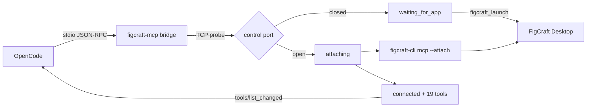

# figcraft-mcp-bridge

A **Bun + TypeScript** MCP bridge that connects [OpenCode](https://opencode.ai) to
**FigCraft Desktop** through `figcraft-cli mcp --attach <port>`. The MCP server key is
`figcraft-mcp`; this repository is deliberately named differently so it cannot be
confused with the unrelated third-party project of the same name.

The bridge is **long-running**: it can stay alive while FigCraft is closed and attach
automatically as soon as the control port opens. An agent can even start FigCraft itself
with the `figcraft_launch` tool, so designing never requires restarting OpenCode.

[](https://github.com/muhnazih029/figcraft-mcp-bridge/actions/workflows/ci.yml)
[](LICENSE)
[](https://bun.sh)
[](https://modelcontextprotocol.io)

## Table of contents

- [Features](#features)
- [Requirements](#requirements)
- [Quickstart](#quickstart)
- [Architecture and status flow](#architecture-and-status-flow)
- [Tools](#tools)
- [Status behaviour (why it does not become "connecting")](#status-behaviour-why-it-does-not-become-connecting)
- [Diagnostics](#diagnostics)
- [Logging](#logging)
- [Configuration](#configuration)
- [Example prompts](#example-prompts)
- [Helper scripts](#helper-scripts)
- [Try it yourself](#try-it-yourself)
- [Development](#development)
- [License](#license)
- [Security](#security)

## Features

- Auto-attach to FigCraft when its control port opens (~1.5 s).
- Auto-reconnect when FigCraft is closed and reopened.
- **`figcraft_launch`** — the agent can start FigCraft with its control port itself.
- **`figcraft_status`** — state, port, FigCraft processes, diagnostics, errors, retry count.
- **`figcraft_commands`** — design tool list, or diagnostics when not connected.
- Port auto-detection from the running process' `--control` flag (`FIGCRAFT_PORT=auto`).
- All 19 FigCraft design tools are forwarded as-is (`create_node`, `batch`, `screenshot`, ...).
- `tools/list_changed` is sent to OpenCode, so tools appear/disappear without a restart.
- Rotating log file.

## Requirements

| Requirement | Notes |
|---|---|
| [Bun](https://bun.sh) | runs the MCP server |
| FigCraft Desktop >= 0.18.1 | must ship `figcraft-cli` with the `mcp --attach` subcommand |
| OpenCode | with local (stdio) MCP support |

Quick check:

```bash
bun --version
figcraft --version
figcraft-cli mcp --help | head
```

If `figcraft-cli` is not on `PATH`, set `FIGCRAFT_CLI_PATH` to its absolute path
(for example the path inside an AppImage).

## Quickstart

### 1. Clone and install

```bash
git clone https://github.com/muhnazih029/figcraft-mcp-bridge.git
cd figcraft-mcp-bridge
bun install
bunx tsc --noEmit
```

### 2. Register the MCP server in OpenCode

Add this to `~/.config/opencode/opencode.json` (or your OpenCode config):

```json
{
  "mcp": {
    "servers": {
      "figcraft-mcp": {
        "type": "local",
        "command": ["bun", "run", "/ABSOLUTE/PATH/TO/figcraft-mcp-bridge/src/index.ts"],
        "environment": { "FIGCRAFT_PORT": "auto" },
        "enabled": true
      }
    }
  }
}
```

Replace `/ABSOLUTE/PATH/TO/...` with the output of `pwd` from step 1. Restart OpenCode
once after adding this entry.

An example file is available at [`examples/opencode.json`](examples/opencode.json).

### 3. Make sure FigCraft can start with a control port

FigCraft must be launched with `--control <port>`. The safest way:

```bash
./scripts/install.sh          # installs the launcher and the .desktop override
```

Or edit the FigCraft `.desktop` entry manually:

```ini
Exec=/path/to/figcraft --control 7979 %U
```

Then run `update-desktop-database ~/.local/share/applications`.

### 4. Use it

Open OpenCode and ask for a design. If FigCraft is not running, the agent calls
`figcraft_launch`; the app starts, the bridge attaches, and the design tools appear.

Alternatively, open FigCraft from your launcher/DMS — the bridge will attach either way.

## Architecture and status flow



The bridge keeps its own process alive, so FigCraft can be closed and reopened any
number of times without restarting OpenCode.

## Tools

| Tool | Purpose |
|---|---|
| `figcraft_status` | Full connection status plus diagnostics |
| `figcraft_commands` | Design tool list, or hints when not connected |
| `figcraft_launch({ waitMs? })` | Start/reuse FigCraft and attach |
| 19 design tools | Forwarded from `figcraft-cli mcp --attach` while `connected` |

The design tools are `list_commands`, `run_command`, `batch`, `create_node`,
`set_properties`, `inspect_document`, `get_node`, `select`, `export`, `screenshot`,
`open_file`, `save_file`, `undo`, `redo`, `pointer`, `key`, `type_text`,
`inspect_ui`, and `wait_for_changes`.

## Status behaviour (why it does not become "connecting")

OpenCode only has two states for a local MCP server: **connected** and **failed**.
A server is marked `failed` when its process exits, and OpenCode **never restarts**
local processes that died (`packages/core/src/mcp/index.ts`, `stdio.ts`).

Pencil appears to "turn into an error and then connect" because its MCP binary lives
inside the AppImage mount; when the app closes, the mount disappears, the MCP process
dies, and OpenCode marks it failed. Opening the app again makes the binary reappear,
but a reload/restart is still normally required to spawn it again.

This bridge deliberately does the opposite: it stays alive when FigCraft closes,
removes the design tools via `notifications/tools/list_changed`, and exposes
`figcraft_status` as the diagnostic centre. The result is that you can open and close
FigCraft repeatedly without restarting OpenCode. A fail-fast mode like Pencil's is
possible, but then reopening FigCraft would require an OpenCode restart.

## Diagnostics

When the port is closed, the bridge reads `/proc/<pid>/cmdline` to distinguish three cases:

| Condition | `diagnostic` field |
|---|---|
| FigCraft running without `--control` | `FigCraft is running without a control port (pid N)` |
| FigCraft running on another port | `FigCraft is running on control port X, but this bridge expects Y` |
| No FigCraft process | empty |

With `FIGCRAFT_PORT=auto`, the port of a running process is adopted automatically.

## Logging

```bash
tail -f ~/.local/share/figcraft-mcp/bridge.log
```

The log rotates to `bridge.log.1` when it exceeds `FIGCRAFT_LOG_MAX_BYTES`.

## Configuration

| Variable | Default | Notes |
|---|---|---|
| `FIGCRAFT_HOST` | `127.0.0.1` | the control server must bind to loopback |
| `FIGCRAFT_PORT` | `7979` | use `auto` to follow the process' `--control` flag |
| `FIGCRAFT_CLI_PATH` | `/usr/bin/figcraft-cli` | absolute paths are allowed |
| `FIGCRAFT_APP_PATH` | `/usr/bin/figcraft` | used by `figcraft_launch` |
| `FIGCRAFT_POLL_INTERVAL_MS` | `1500` | |
| `FIGCRAFT_ATTACH_TIMEOUT_MS` | `5000` | |
| `FIGCRAFT_LAUNCH_TIMEOUT_MS` | `20000` | |
| `FIGCRAFT_LOG_FILE` | `~/.local/share/figcraft-mcp/bridge.log` | `none` disables it |
| `FIGCRAFT_LOG_MAX_BYTES` | `1000000` | before rotating to `.1` |

Example with non-standard paths:

```json
"environment": {
  "FIGCRAFT_PORT": "auto",
  "FIGCRAFT_CLI_PATH": "/opt/figcraft/figcraft-cli",
  "FIGCRAFT_APP_PATH": "/opt/figcraft/figcraft"
}
```

## Example prompts

```text
Check the FigCraft status first. If it is not connected, open the app, then create a
340x440 profile card with a purple avatar, the name "Nazih", the role "Design Engineer",
and a black CTA button labelled "Let's collaborate →".
```

```text
Inspect the open document, then add a new frame to the right containing three feature
cards with vertical auto-layout, gap 16 and padding 24. Do not touch the existing
portfolio frame.
```

```text
List the available FigCraft commands and explain which ones create components and
variables. Do not modify the document yet.
```

Tip: ask the agent to call `figcraft_status` before designing so the connection and
document state are clear.

## Helper scripts

```bash
./scripts/install.sh                   # check deps, install launcher + .desktop, print config
./scripts/uninstall.sh                 # remove launcher + .desktop + MCP entry (with .bak backups)
./scripts/uninstall.sh --keep-config   # remove files only, keep configuration
./scripts/doctor.sh                    # check binaries, port, .desktop entry and recent log
```

## Try it yourself

1. **Check the environment:**
   ```bash
   ./scripts/doctor.sh
   ```
   You should see `OK figcraft`, `OK figcraft-cli`, `OK pid ... --control 7979`,
   and `OK port 7979 is reachable`.

2. **Watch the log in another terminal:**
   ```bash
   tail -f ~/.local/share/figcraft-mcp/bridge.log
   ```

3. **In OpenCode, call `figcraft_status`** — expect `state: connected` and 19 tools
   in `backendToolNames`.

4. **Close FigCraft.** The log writes:
   `state connected -> waiting_for_app (FigCraft Desktop control port closed)`.
   The design tools disappear, but MCP does not error.

5. **Reopen it in either of two ways:**
   - from chat: call `figcraft_launch` — the app starts and attaches in ~1.5 s;
   - from your DMS/launcher: click FigCraft as usual (the `.desktop` entry carries
     `--control`).

6. **Verify:** `figcraft_status` returns `connected`, and the log shows
   `state waiting_for_app -> attaching -> connected (19 tools)`.

7. **Optionally test uninstall/reinstall:**
   ```bash
   ./scripts/uninstall.sh
   ./scripts/install.sh
   ```
   Restart OpenCode once, then repeat steps 3-6.

## Development

See [`CONTRIBUTING.md`](CONTRIBUTING.md). In short:

```bash
bun install
bun run typecheck
bun run test
bun run smoke     # works without FigCraft installed
```

GitHub Actions CI runs all four checks on every push and pull request.

## License

MIT — see [`LICENSE`](LICENSE).

## Security

The FigCraft control port is a **loopback TCP socket with no authentication**.
Any process running as the same user on the same machine can connect and send design
commands (read documents, edit layers, export/save files). Never forward this port
to a network.
