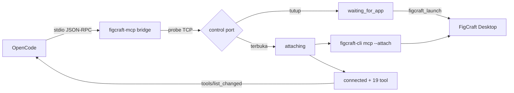

# figcraft-mcp-bridge

Bridge MCP berbasis **Bun + TypeScript** yang menghubungkan [OpenCode](https://opencode.ai)
ke **FigCraft Desktop** lewat `figcraft-cli mcp --attach <port>`. Nama tool/MCP-server-nya
adalah `figcraft-mcp`; nama repositori ini sengaja dibedakan supaya tidak tertukar dengan
proyek pihak ketiga yang bernama sama.

Bridge ini **long-running**: bisa hidup walaupun FigCraft belum dibuka, lalu attach otomatis
begitu control port tersedia. Agent bisa menyalakan FigCraft sendiri lewat tool
`figcraft_launch`, jadi alur desain tidak perlu restart OpenCode.

[](https://github.com/muhnazih029/figcraft-mcp-bridge/actions/workflows/ci.yml)
[](LICENSE)
[](https://bun.sh)
[](https://modelcontextprotocol.io)

## Daftar isi

- [Fitur](#fitur)
- [Requirements](#requirements)
- [Quickstart](#quickstart)
- [Arsitektur & alur status](#arsitektur--alur-status)
- [Tools](#tools)
- [Perilaku status](#perilaku-status-kenapa-tidak-jadi-connecting)
- [Diagnosa](#diagnosa)
- [Log](#log)
- [Konfigurasi](#konfigurasi)
- [Contoh prompt](#contoh-prompt)
- [Skrip bantu](#skrip-bantu)
- [Mencoba sendiri](#mencoba-sendiri)
- [Development](#development)
- [Keamanan](#keamanan)

## Arsitektur & alur status



Bridge mempertahankan prosesnya sendiri, sehingga FigCraft bisa ditutup/dibuka
berkali-kali tanpa me-restart OpenCode.

## Fitur

- Auto-attach ke FigCraft saat control port terbuka (~1,5 detik).
- Auto-reconnect saat FigCraft ditutup lalu dibuka lagi.
- **`figcraft_launch`** — agent bisa menyalakan FigCraft dengan control port sendiri.
- **`figcraft_status`** — state, port, proses FigCraft, diagnosa, error, jumlah retry.
- **`figcraft_commands`** — daftar tool design, atau diagnosa saat belum terhubung.
- Port auto-detect dari `--control` di proses FigCraft (`FIGCRAFT_PORT=auto`).
- 19 tool design FigCraft diteruskan apa adanya (`create_node`, `batch`, `screenshot`, dst.).
- `tools/list_changed` dikirim ke OpenCode, jadi tool muncul/hilang tanpa restart.
- Log file dengan rotasi otomatis.

## Requirements

| Kebutuhan | Catatan |
|---|---|
| [Bun](https://bun.sh) | untuk menjalankan server MCP |
| FigCraft Desktop ≥ 0.18.1 | harus punya `figcraft-cli` dengan subcommand `mcp --attach` |
| OpenCode | dengan dukungan MCP lokal (stdio) |

Cek cepat:

```bash
bun --version
figcraft --version
figcraft-cli mcp --help | head
```

Kalau `figcraft-cli` tidak ada di PATH, set `FIGCRAFT_CLI_PATH` ke path absolutnya
(mis. path di dalam AppImage).

## Quickstart

### 1. Clone & install

```bash
git clone https://github.com/muhnazih029/figcraft-mcp-bridge.git
cd figcraft-mcp-bridge
bun install
bunx tsc --noEmit
```

### 2. Daftarkan MCP ke OpenCode

Tambahkan ke `~/.config/opencode/opencode.json` (atau config OpenCode kamu):

```json
{
  "mcp": {
    "servers": {
      "figcraft-mcp": {
        "type": "local",
        "command": [
          "bun",
          "run",
          "/PATH_ABSOLUT/KE/figcraft-mcp/src/index.ts"
        ],
        "environment": { "FIGCRAFT_PORT": "auto" },
        "enabled": true
      }
    }
  }
}
```

Ganti `/PATH_ABSOLUT/KE/...` dengan hasil `pwd` di langkah 1. Restart OpenCode
sekali setelah menambahkan entry ini.

### 3. Pastikan FigCraft bisa dibuka dengan control port

FigCraft harus diluncurkan dengan `--control <port>`. Cara paling aman:

```bash
./scripts/install.sh          # pasang launcher + override .desktop
```

Atau manual — ubah entry `.desktop` FigCraft menjadi:

```ini
Exec=/path/ke/figcraft --control 7979 %U
```

Lalu `update-desktop-database ~/.local/share/applications`.

### 4. Pakai

Buka OpenCode, lalu minta agent mendesain. Kalau FigCraft belum jalan, agent
memanggil `figcraft_launch`; aplikasi menyala, bridge attach, tool design muncul.

Atau buka FigCraft dari launcher/DMS — bridge tetap akan attach otomatis.

## Tools

| Tool | Fungsi |
|---|---|
| `figcraft_status` | Status koneksi lengkap + diagnosa |
| `figcraft_commands` | Daftar tool design / hint saat belum connect |
| `figcraft_launch({ waitMs? })` | Nyalakan FigCraft + attach |
| 19 tool design | Diteruskan dari `figcraft-cli mcp --attach` saat `connected` |

Tool design meliputi `list_commands`, `run_command`, `batch`, `create_node`,
`set_properties`, `inspect_document`, `get_node`, `select`, `export`, `screenshot`,
`open_file`, `save_file`, `undo`, `redo`, `pointer`, `key`, `type_text`,
`inspect_ui`, `wait_for_changes`.

## Perilaku status (kenapa tidak jadi "connecting")

OpenCode hanya punya dua status untuk MCP lokal: **connected** dan **failed**.
Status `failed` terjadi kalau **proses MCP mati**, dan OpenCode **tidak** me-restart
proses lokal yang mati.

Pencil terlihat "berubah jadi error" karena biner MCP-nya berada di dalam mount
AppImage yang hilang saat aplikasinya ditutup — jadi proses MCP ikut mati. Saat
aplikasi dibuka, OpenCode perlu reload/restart untuk bisa spawn ulang.

Bridge ini sengaja melakukan sebaliknya: proses tetap hidup saat FigCraft mati,
tool design dicabut lewat `notifications/tools/list_changed`, dan `figcraft_status`
menjadi pusat diagnosa. Hasilnya: FigCraft bisa dibuka/tutup berkali-kali tanpa
restart OpenCode. Kalau menginginkan perilaku fail-fast seperti Pencil, jalankan
dengan varian konfigurasi yang menghentikan bridge saat app mati — tapi konsekuensinya
OpenCode harus direstart setelah FigCraft dibuka kembali.

## Diagnosa

Saat port tertutup, bridge membaca `/proc/<pid>/cmdline` untuk membedakan:

| Kondisi | Field `diagnostic` |
|---|---|
| FigCraft jalan tanpa `--control` | `FigCraft is running without a control port (pid N)` |
| FigCraft jalan di port lain | `FigCraft is running on control port X, but this bridge expects Y` |
| Tidak ada proses FigCraft | kosong |

Dengan `FIGCRAFT_PORT=auto`, port dari proses diadopsi otomatis.

## Log

```bash
tail -f ~/.local/share/figcraft-mcp/bridge.log
```

Rotasi otomatis ke `bridge.log.1` saat ukuran melewati `FIGCRAFT_LOG_MAX_BYTES`.

## Konfigurasi

| Variable | Default | Catatan |
|---|---|---|
| `FIGCRAFT_HOST` | `127.0.0.1` | control server harus bind loopback |
| `FIGCRAFT_PORT` | `7979` | `auto` = ikuti `--control` proses FigCraft |
| `FIGCRAFT_CLI_PATH` | `/usr/bin/figcraft-cli` | path absolut juga boleh |
| `FIGCRAFT_APP_PATH` | `/usr/bin/figcraft` | dipakai `figcraft_launch` |
| `FIGCRAFT_POLL_INTERVAL_MS` | `1500` | |
| `FIGCRAFT_ATTACH_TIMEOUT_MS` | `5000` | |
| `FIGCRAFT_LAUNCH_TIMEOUT_MS` | `20000` | |
| `FIGCRAFT_LOG_FILE` | `~/.local/share/figcraft-mcp/bridge.log` | `none` = matikan |
| `FIGCRAFT_LOG_MAX_BYTES` | `1000000` | sebelum rotasi |

Contoh memakai paths non-standar:

```json
"environment": {
  "FIGCRAFT_PORT": "auto",
  "FIGCRAFT_CLI_PATH": "/opt/figcraft/figcraft-cli",
  "FIGCRAFT_APP_PATH": "/opt/figcraft/figcraft"
}
```

## Contoh prompt

Beberapa prompt yang langsung bisa dipakai setelah MCP terpasang:

```text
Cek status FigCraft dulu. Kalau belum nyambung, buka aplikasinya lalu buat
kartu profil 340x440 dengan avatar ungu, nama "Nazih", role "Design Engineer",
dan tombol CTA hitam bertuliskan "Let's collaborate →".
```

```text
Inspect dokumen yang sedang terbuka, lalu tambahkan frame baru di sebelah kanan
berisi tiga kartu fitur dengan auto-layout vertikal, gap 16, padding 24.
Jangan ubah frame portfolio yang sudah ada.
```

```text
Baca daftar command FigCraft yang tersedia, lalu jelaskan mana saja yang bisa
dipakai untuk membuat component dan variable. Belum perlu mengubah dokumen.
```

Tips: minta agent memanggil `figcraft_status` sebelum mendesain supaya
keadaan koneksi dan dokumen jelas.

## Skrip bantu

```bash
./scripts/install.sh              # cek dependency, pasang launcher + .desktop, cetak snippet config
./scripts/uninstall.sh            # hapus launcher + .desktop + entry config (backup .bak)
./scripts/uninstall.sh --keep-config   # hapus file saja, config dipertahankan
./scripts/doctor.sh               # cek biner, port, entry .desktop, dan log terakhir
```

## Mencoba sendiri

1. **Cek dulu lingkungan:**
   ```bash
   ./scripts/doctor.sh
   ```
   Harus muncul `OK figcraft`, `OK figcraft-cli`, `OK pid ... --control 7979`,
   dan `OK port 7979 bisa dihubungkan`.

2. **Pantau log di terminal terpisah:**
   ```bash
   tail -f ~/.local/share/figcraft-mcp/bridge.log
   ```

3. **Di OpenCode, cek status:**
   panggil `figcraft_status` → `state: connected`, 19 tool di `backendToolNames`.

4. **Tutup FigCraft.** Log akan menulis:
   `state connected -> waiting_for_app (FigCraft Desktop control port closed)`.
   Tool design hilang dari OpenCode, tapi MCP tidak error.

5. **Buka lagi dengan dua cara (pilih salah satu):**
   - dari chat: panggil `figcraft_launch` → aplikasi menyala sendiri, attach ~1,5 detik;
   - dari DMS/launcher: klik FigCraft seperti biasa (entry `.desktop` sudah
     membawa `--control`).

6. **Verifikasi:** `figcraft_status` → `connected`, dan log:
   `state waiting_for_app -> attaching -> connected (19 tools)`.

7. **Uji uninstall/pasang ulang** kalau perlu:
   ```bash
   ./scripts/uninstall.sh
   ./scripts/install.sh
   ```
   Lalu restart OpenCode sekali.

## Troubleshooting

| Gejala | Penyebab | Solusi |
|---|---|---|
| `figcraft_status` → `waiting_for_app`, `appProcesses` kosong | FigCraft belum jalan | Panggil `figcraft_launch` atau buka dari DMS |
| `diagnostic`: app jalan tanpa control port | `.desktop` belum pakai `--control` | Jalankan `scripts/install.sh` |
| `diagnostic`: port mismatch | launcher pakai port lain | Pakai `FIGCRAFT_PORT=auto` |
| MCP tidak muncul di OpenCode | entry belum ada / OpenCode belum reload | Tambahkan entry, restart OpenCode |
| Tool design tidak muncul | bridge belum attach | Cek `figcraft_status`, lalu `figcraft_launch` |

## Development

Lihat [`CONTRIBUTING.md`](CONTRIBUTING.md). Ringkas:

```bash
bun install
bun run typecheck
bun run test
bun run smoke     # tidak butuh FigCraft terpasang
```

CI GitHub Actions menjalankan keempatnya pada setiap push/PR.

## License

MIT — lihat [`LICENSE`](LICENSE).

## Keamanan

Control port FigCraft adalah TCP **loopback** (`127.0.0.1`) **tanpa token**.
Hanya proses di mesin yang sama yang bisa terhubung, tetapi proses itu bisa
mengirim perintah desain (baca dokumen, ubah layer, export/save). Jangan pernah
meneruskan port ini ke jaringan.
